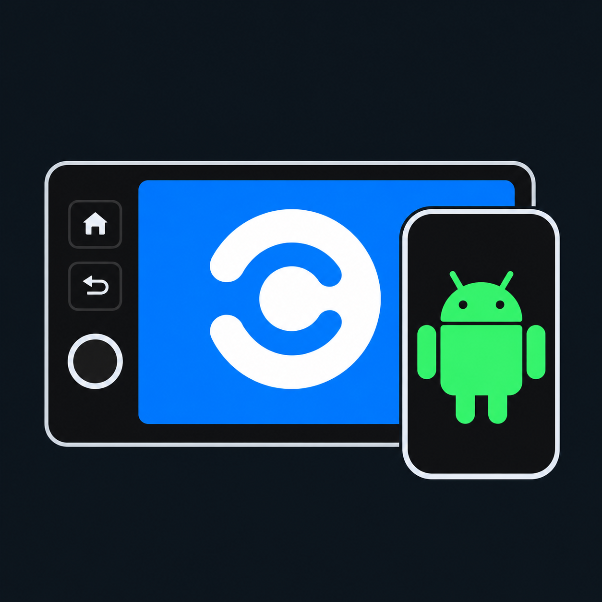
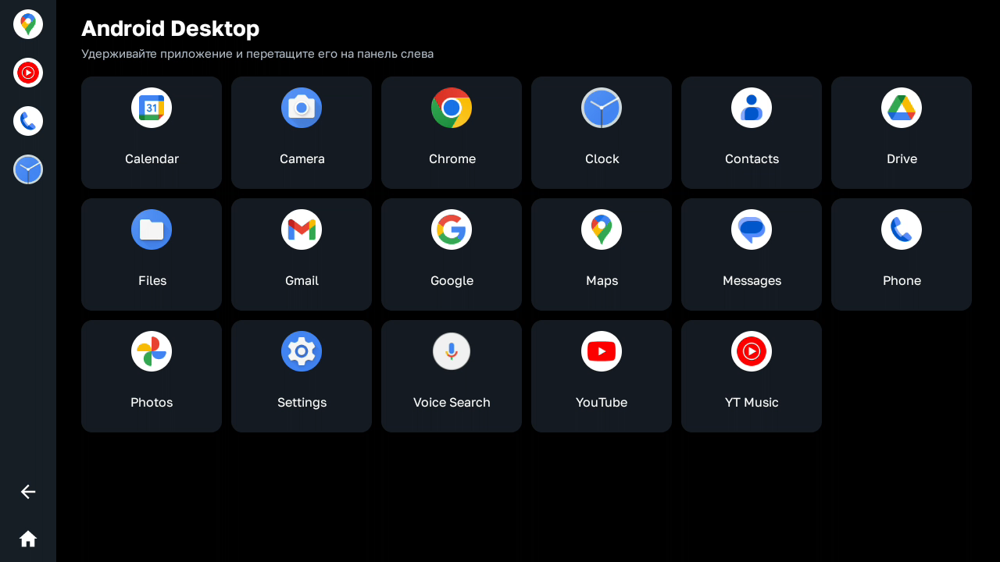
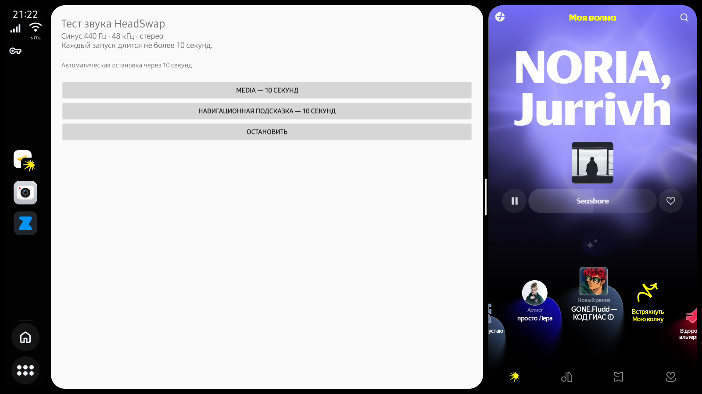
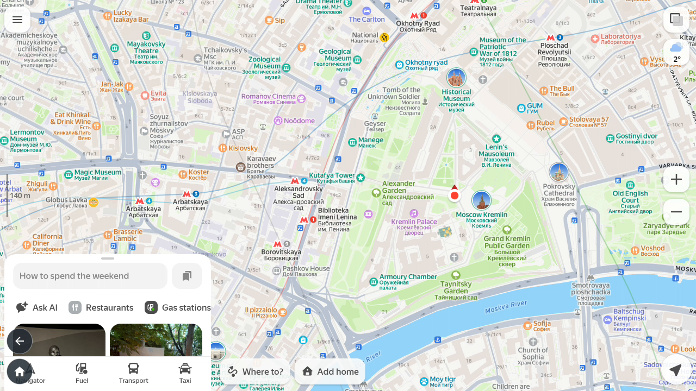
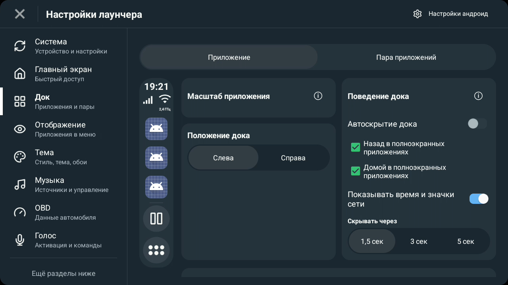

# HeadSwap Desktop

HeadSwap Desktop выводит приложения Android-телефона на штатную магнитолу с **Baidu CarLife по USB**. На ГУ появляется отдельный рабочий стол. Касания с магнитолы передаются телефону, а установленный на телефоне домашний экран сохраняется.

**[Предварительный выпуск HeadSwap Desktop 0.5.0](https://github.com/SadykovIV/headswap_desk/releases/tag/v0.5.0) · Android 13+ · пакет `com.headswap.desk`.** Публичный стабильный выпуск — [HeadSwap Desktop 0.4.1](https://github.com/SadykovIV/headswap_desk/releases/tag/v0.4.1).

В Android Desktop можно собрать свою боковую панель. Удерживайте приложение в каталоге и перетащите его влево, чтобы закрепить. Для удаления удерживайте иконку на панели и нажмите корзину. Внизу панели доступны «Назад» и «Домой». В «Настройки → Компоненты HeadSwap Desktop» отдельно показаны основное приложение и DriveDeck. Здесь можно проверить обновления и установить совместимый DriveDeck.

[Скачать HeadSwap Desktop и DriveDeck · HeadSwap](https://github.com/SadykovIV/headswap_desk/releases) · [Установка и запуск](INSTALL.md)

В Android Desktop и DriveDeck штатная клавиатура открывается в окне приложения на ГУ, в том числе при погашенной панели телефона. Кнопка «Назад» магнитолы скрывает клавиатуру. Совместимой приборной панели и HUD HeadSwap передаёт текущую песню из медиасессии Android и ближайший манёвр из навигационного уведомления Яндекса. На Android 16 и новее HeadSwap также читает стрелку и расстояние из видимой карточки Навигатора или Карт в окне проекции. [Как настроить клавиатуру и подсказки](INSTALL.md#клавиатура-и-приборная-панель)

| Профиль | Что появляется на ГУ | Что установить на телефон |
| --- | --- | --- |
| Android Desktop | Рабочий стол с постоянной панелью приложений и навигацией слева | HeadSwap Desktop |
| DriveDeck | Автомобильный лаунчер с картой и музыкальным плеером. Совместимые приложения можно расположить рядом | HeadSwap Desktop и адаптированный DriveDeck 0.6.8 code305 |
| Samsung DeX | Рабочий стол DeX на совместимом Samsung | HeadSwap Desktop и Shizuku или встроенный ADB |

На новой установке рабочий стол использует 1280 × 720, 15 кадров/с и 128 DPI. Профиль, активация и подключение находятся на главном экране. В «Настройках» можно выбрать разрешение, DPI и частоту до 60 кадров/с, настроить звук по USB, таймер панели телефона и подсказки на приборке. Доступные режимы и частота зависят от кодера телефона, приложений и магнитолы.

Выбранный DPI задаёт масштаб рабочего стола магнитолы. В настройках **Исправить DPI приложения** можно добавить приложения для коррекции в Android Desktop и DriveDeck. Карты и Навигатор включены по умолчанию. Основной экран телефона сохраняет системный масштаб. В настройках DriveDeck раздел «Главный экран» позволяет открывать одиночный ярлык из дока на весь экран. В разделе «Док» отдельно включаются круглые кнопки «Назад» и «Домой» поверх приложения в левом нижнем углу. Если включены обе кнопки, «Назад» находится над «Домой». Для двух встроенных окон остаётся обычный док. [Настройки масштаба и кнопок](INSTALL.md#масштаб-карт-и-кнопки-drivedeck)

## На экране головного устройства

На снимках видны список приложений Android Desktop и два приложения, открытые рядом в DriveDeck.

| Домашний экран Android Desktop | Два приложения в DriveDeck |
| --- | --- |
|  |  |

[Как выглядит перенос на панель](docs/screenshots/09-hu-pin.png) · [Все скриншоты телефона и ГУ](docs/screenshots)

| Яндекс Карты во весь экран в DriveDeck | Настройки кнопок DriveDeck |
| --- | --- |
|  |  |

## Авторы и происхождение

- **YegorkaPomidorka** — автор HeadSwap. Из этого проекта взяты USB-транспорт и поддержка протокола Baidu CarLife. Основа адаптации — ревизия `77dc69c`. [HeadSwap](https://github.com/YegorkaPomidorka/headswap) · [Профиль автора](https://github.com/YegorkaPomidorka)
- **RotkivKiv** — автор автомобильного лаунчера DriveDeck. Для работы на отдельном дисплее HeadSwap подготовлены патчи к DriveDeck 0.6.8 code300. [Страница обновлений DriveDeck](https://github.com/RotkivKiv/DriveDeck-Updates) · [Профиль автора](https://github.com/RotkivKiv)
- **SadykovIV** публикует эту независимую адаптацию HeadSwap Desktop. Она добавляет рабочий стол Android, профиль DriveDeck и вывод на CarLife без запуска Android Auto. [Репозиторий адаптации](https://github.com/SadykovIV/headswap_desk)

## Разработчикам компонентов

В предварительной 0.5.0 независимые лаунчеры появляются в списке **«Профиль» на главном экране**. CarBridge — отдельный профиль этого списка. Как и другие независимые профили v1, он работает на движке Android Desktop. Родительский экран, системная навигация, ввод и CarLife остаются у HeadSwap. Автор развивает и подписывает свой APK отдельно. [Полная инструкция и быстрый старт](sdk/desktop-panel-v1/DEVELOPER-GUIDE.md) · [Справочник SDK](sdk/desktop-panel-v1/README.md) · [Как проверить 0.5.0](docs/TESTING-0.5.0.md) · [Границы API](docs/DESKTOP-COMPONENT-API.md) · [Пилот CarBridge](docs/CARBRIDGE-PILOT.md).

## Контакты и поддержка

Связаться с автором HeadSwap Desktop в Telegram — [@sadykovildar](https://t.me/sadykovildar).

**[Поддержать проект через CloudTips](https://pay.cloudtips.ru/p/41f6ecdd)**

## Сборка и лицензии

Исходники HeadSwap Desktop распространяются по GPL-3.0. Изменения для DriveDeck также доступны в виде исходных патчей. Права на исходное приложение и ресурсы DriveDeck принадлежат их правообладателям. [Сборка и сторонние компоненты](BUILDING.md) · [Лицензия](LICENSE)
