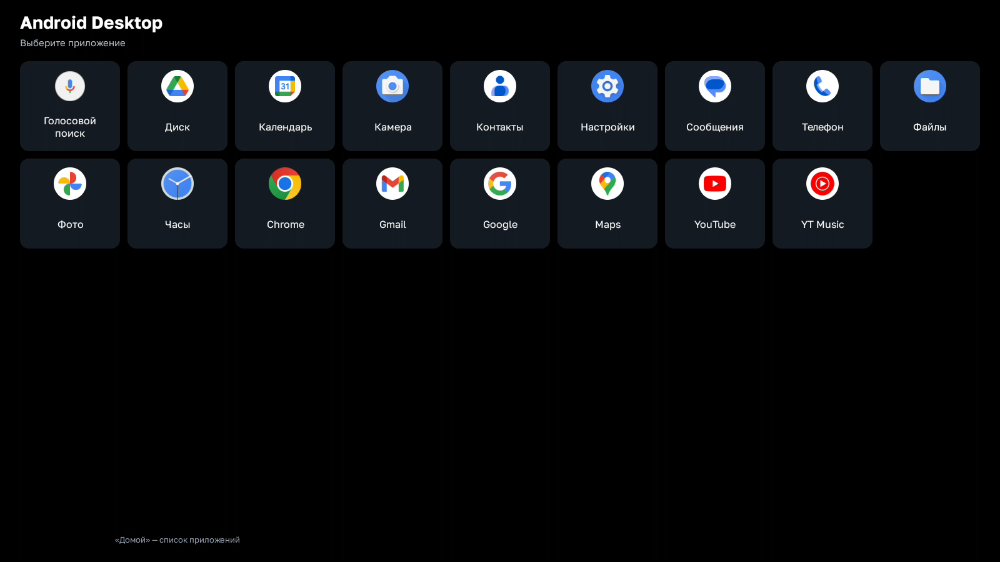

# HeadSwap Desktop

HeadSwap Desktop выводит приложения Android-телефона на штатную магнитолу с **Baidu CarLife по USB**. На ГУ появляется отдельный рабочий стол. Касания с магнитолы передаются телефону, а установленный на телефоне домашний экран сохраняется.

**Версия 0.2.16 experimental · Android 13+ · пакет `com.headswap.desk`**

Исправлены активация, выключение и пробуждение экрана телефона на Android 13–17, а также передача музыки и навигационных подсказок по USB.

[Скачать HeadSwap Desktop и DriveDeck · HeadSwap](https://github.com/SadykovIV/headswap_desk/releases/tag/v0.2.16) · [Установка и запуск](INSTALL.md)

| Профиль | Что появляется на ГУ | Что установить на телефон |
| --- | --- | --- |
| Android Desktop | Рабочий стол со списком приложений телефона | HeadSwap Desktop |
| DriveDeck | Автомобильный лаунчер с картой и музыкальным плеером. Совместимые приложения можно расположить рядом | HeadSwap Desktop и адаптированный DriveDeck code263 |
| Samsung DeX | Рабочий стол DeX на совместимом Samsung | HeadSwap Desktop и Shizuku |

При первой активации выбраны передача музыки и подсказок по USB и управление панелью телефона. Снять любую отметку можно в «Дополнительно» перед активацией. Там же задаются разрешение, масштаб интерфейса и целевая частота до 60 кадров/с. Доступные режимы и частота зависят от кодера телефона, приложений и магнитолы.

## На экране головного устройства

На снимках видны список приложений Android Desktop и два приложения, открытые рядом в DriveDeck.

| Домашний экран Android Desktop | Два приложения в DriveDeck |
| --- | --- |
|  |  |

[Все скриншоты телефона и ГУ](docs/screenshots)

## Авторы и происхождение

- **YegorkaPomidorka** — автор HeadSwap. Из этого проекта взяты USB-транспорт и поддержка протокола Baidu CarLife. Основа адаптации — ревизия `77dc69c`. [HeadSwap](https://github.com/YegorkaPomidorka/headswap) · [Профиль автора](https://github.com/YegorkaPomidorka)
- **RotkivKiv** — автор автомобильного лаунчера DriveDeck. Для работы на отдельном дисплее HeadSwap подготовлены патчи к DriveDeck 0.6.7 code258. [Страница обновлений DriveDeck](https://github.com/RotkivKiv/DriveDeck-Updates) · [Профиль автора](https://github.com/RotkivKiv)
- **SadykovIV** публикует эту независимую адаптацию HeadSwap Desktop. Она добавляет рабочий стол Android, профиль DriveDeck и вывод на CarLife без запуска Android Auto. [Репозиторий адаптации](https://github.com/SadykovIV/headswap_desk)

## Контакты и поддержка

Связаться с автором HeadSwap Desktop в Telegram — [@sadykovildar](https://t.me/sadykovildar).

**[Поддержать проект через CloudTips](https://pay.cloudtips.ru/p/41f6ecdd)**

## Сборка и лицензии

Исходники HeadSwap Desktop распространяются по GPL-3.0. Изменения для DriveDeck также доступны в виде исходных патчей. Права на исходное приложение и ресурсы DriveDeck принадлежат их правообладателям. [Сборка и сторонние компоненты](BUILDING.md) · [Лицензия](LICENSE)
